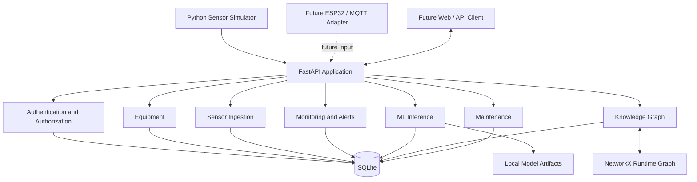
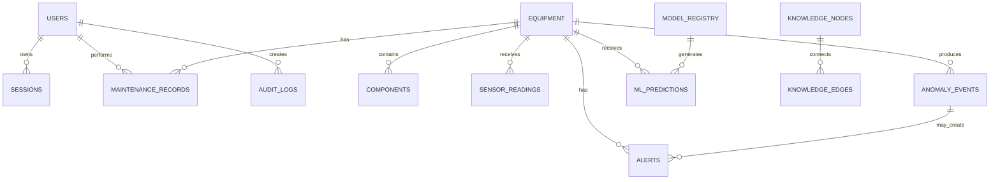
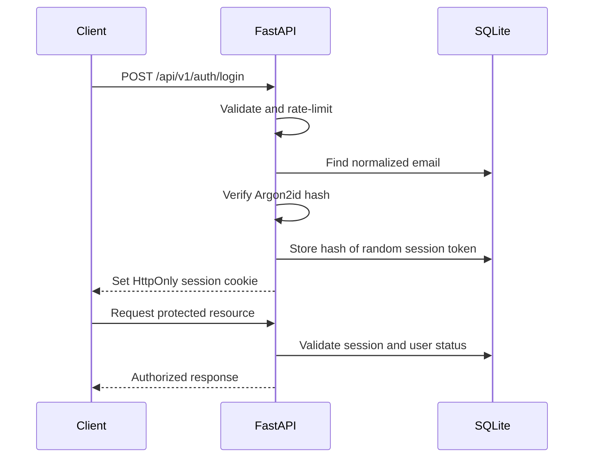

# MechTech — Phase 2: Backend Architecture & Technical Design

**Project:** MechTech — Detect. Diagnose. Maintain.  
**Equipment:** Electric motor  
**Phase:** 2 — Backend architecture and technical design  
**Primary focus:** Backend, APIs, database, storage, performance, security and authentication  
**Deferred:** Frontend implementation, 3D visualization implementation, deployment and physical hardware integration  
**Status:** Technical baseline for implementation. Treat decisions as proposed until verified during development.

---

## 0. Instructions for the AI coding assistant

This document defines the Phase 2 backend design. Read it before generating or changing project code.

1. Do not start frontend or deployment work in this phase.
2. Build a reliable backend first, in small verifiable milestones.
3. Do not generate the entire application in one response. Propose a milestone, implement it, run tests, explain changed files and wait for review.
4. Do not invent requirements that conflict with this document. If a decision is genuinely missing, identify it and propose a sensible default.
5. Keep the implementation compatible with Windows 11 and local development in VS Code.
6. Use free, locally runnable tools. No paid API, cloud database, hosted model or subscription is required.
7. Never hard-code secrets, passwords, API keys or administrator credentials.
8. Do not claim simulated sensor data proves real-world motor fault detection.
9. Keep business logic independent of HTTP routes and frontend code.
10. Add tests with each backend feature. Do not mark a milestone complete until its acceptance criteria pass.
11. Prefer simple, maintainable solutions over unnecessary infrastructure. Do not introduce microservices, Kubernetes, Redis, Kafka, Celery or a second database without a measured requirement.
12. Before installing a dependency, explain why it is needed and check whether an existing dependency already provides the capability.

---

## 1. Phase 2 objectives

Convert the Phase 1 requirements into an implementation-ready backend design.

### Priority order

1. Backend architecture and module boundaries
2. Database schema, relationships, constraints and migrations
3. REST API design, validation and consistent errors
4. Sensor-data ingestion, deduplication and storage
5. Authentication and session lifecycle
6. Role-based access control
7. Security controls and audit logging
8. Performance, concurrency and data retention
9. ML training/inference integration
10. Repair knowledge graph persistence and APIs
11. Testing, logging, backup and recovery

### Out of scope for this phase

- Building React pages or dashboard UI
- Implementing the realistic 3D motor model
- Public deployment or cloud hosting
- Buying ESP32 boards or physical sensors
- Integrating an industrial PLC or real factory equipment
- External paid AI APIs
- Microservices or distributed infrastructure

The backend must expose stable, documented contracts that can support these future features without redesigning the core system.

---

## 2. Proposed technology decisions

| Layer | Technology | Reason |
|---|---|---|
| Language | Python | Existing project fit and ML ecosystem |
| API framework | FastAPI | Typed REST APIs, validation and OpenAPI |
| Validation | Pydantic v2 | Request/response schemas |
| ORM | SQLAlchemy 2.x | Database access and transaction control |
| Migrations | Alembic | Versioned schema changes |
| Initial database | SQLite | Free, local-first, low setup |
| Password hashing | Argon2id through a maintained library | Password storage |
| Authentication | Opaque server-side sessions | Revocable browser sessions |
| ML | NumPy, Pandas, SciPy, scikit-learn | Local data processing and models |
| Graph | NetworkX | In-process graph traversal |
| Persistent graph data | SQLite | Durable source of truth |
| Testing | pytest, HTTPX test client | Unit and API integration tests |
| Code quality | Ruff | Linting and formatting |
| API documentation | FastAPI OpenAPI docs | Inspect and test contracts locally |
| Sensor input | Python simulator initially | No hardware purchase required |

Use compatible, maintained package versions and pin dependencies after verifying the environment. Avoid adding a library merely because it appears in a suggested stack.

### Important architecture decisions

- Start as a **modular monolith**, not microservices.
- Start with SQLite; keep data-access boundaries clean enough to migrate to PostgreSQL if measured needs require it.
- Use REST first. Add WebSockets after reliable ingestion and query APIs work.
- Use local files for model artifacts and future attachments; store metadata and controlled paths in SQLite.
- SQLite is the persistent source of truth for the knowledge graph; NetworkX is a runtime representation.
- Train ML models using explicit scripts. Do not train inside request handlers.
- Do not use a cloud LLM to make core fault predictions. The initial ML pipeline must run locally.

---

## 3. System architecture

### 3.1 Modular monolith

MechTech should initially run as one FastAPI application with clearly separated modules. This reduces operational complexity while keeping responsibilities isolated.



### 3.2 Request lifecycle

1. Client sends an HTTP request.
2. Middleware assigns or propagates a request ID.
3. Authentication identifies the caller.
4. Authorization checks role and resource permissions.
5. Pydantic validates the input.
6. A thin route calls an application service.
7. The service applies business rules and uses data-access functions.
8. SQLAlchemy performs a short transaction.
9. The API returns a documented response.
10. Structured logs record safe diagnostic context.

### 3.3 Architecture rules

- Routes handle HTTP concerns only.
- Business rules belong in services.
- Database queries belong in repositories or clearly separated data-access functions.
- Pydantic schemas are not SQLAlchemy models.
- ML implementation must not be embedded in route handlers.
- Do not hold a database transaction open during ML inference, file processing or network calls.
- Do not use NetworkX as the only copy of graph data.
- The future frontend must communicate through APIs, never directly with SQLite.
- No API endpoint may execute arbitrary Python or SQL supplied by a client.

---

## 4. Backend modules and responsibilities

| Module | Responsibility |
|---|---|
| `core` | Configuration, settings, dependencies, exceptions and shared utilities |
| `auth` | Login, logout, sessions, password hashing and session revocation |
| `users` | User administration and account status |
| `equipment` | Electric motor profiles and components |
| `sensors` | Reading validation, ingestion, deduplication and retrieval |
| `monitoring` | Latest status, trends and stale-data detection |
| `alerts` | Alert creation, acknowledgement, resolution and history |
| `ml` | Feature preparation, model loading, inference and evaluation metadata |
| `knowledge_graph` | Graph persistence, construction, traversal and updates |
| `maintenance` | Inspections, repair records and outcomes |
| `audit` | Important security and business events |
| `storage` | Database path, model artifacts, exports and backups |

### Recommended call flow

```text
HTTP route
  -> Pydantic schema
  -> application service
  -> repository / data-access function
  -> SQLAlchemy model
  -> SQLite
```

Keep dependencies explicit. For example, sensor ingestion may request analysis through an ML service interface, but it should not import the internals of a particular model.

---

## 5. Database design

### 5.1 SQLite rationale and limitations

SQLite is appropriate for the first local prototype because it is free, serverless and easy to back up. It supports transactions, constraints, indexes and foreign keys.

However:

- SQLite allows multiple readers but serializes writes.
- WAL mode improves reader/writer coexistence; it does not provide multiple simultaneous writers.
- A single SQLite file should not be shared by multiple independent application instances.
- A busy timeout helps handle brief contention; it does not fix sustained write overload.
- If measured write contention or multi-user deployment becomes significant, benchmark a move to PostgreSQL.

### 5.2 Initial tables

Create these tables through SQLAlchemy models and Alembic migrations:

1. `users`
2. `sessions`
3. `equipment`
4. `components`
5. `sensor_readings`
6. `anomaly_events`
7. `ml_predictions`
8. `alerts`
9. `maintenance_records`
10. `model_registry`
11. `knowledge_nodes`
12. `knowledge_edges`
13. `audit_logs`

Potential later tables: `device_credentials`, `simulator_runs`, `attachments`, `password_reset_tokens` and `email_verification_tokens`. Do not add them until the corresponding feature is approved.

### 5.3 Conceptual relationships



This is a conceptual ER model. Confirm nullability, deletion behaviour and optional relationships in the actual migrations.

### 5.4 Table specifications

#### `users`

| Field | Purpose / rule |
|---|---|
| `id` | Primary key |
| `name` | Required display name |
| `email` | Required, normalized and unique |
| `password_hash` | Argon2id hash; never plaintext |
| `role` | `admin`, `technician` or `operator` |
| `is_active` | Boolean, default true |
| `created_at`, `updated_at` | UTC timestamps |

Normalize email consistently before checking uniqueness. Do not return `password_hash` in API responses.

#### `sessions`

| Field | Purpose / rule |
|---|---|
| `id` | Primary key |
| `user_id` | Foreign key to users |
| `token_hash` | Unique hash of random session token |
| `created_at` | UTC timestamp |
| `expires_at` | UTC timestamp |
| `last_seen_at` | UTC timestamp |
| `revoked_at` | Nullable UTC timestamp |
| `user_agent_summary` | Optional, limited security context |

Store only the hash of the raw session token. The raw token is returned to the browser in a cookie and is not stored in the database.

#### `equipment`

| Field | Purpose / rule |
|---|---|
| `id` | Primary key |
| `name` | Required equipment name |
| `category` | Initially `electric_motor` |
| `manufacturer` | Optional |
| `model_number` | Optional |
| `serial_number` | Optional |
| `location` | Optional |
| `description` | Optional |
| `status` | Configured operational status |
| `created_at`, `updated_at` | UTC timestamps |

Do not assume that every motor's rated speed, power, voltage or other specification is known. Add optional fields only when required and validated.

#### `components`

| Field | Purpose / rule |
|---|---|
| `id` | Primary key |
| `equipment_id` | Foreign key |
| `component_key` | Stable identifier for graph and future 3D mapping |
| `name` | Required |
| `description` | Optional |

Potential keys include `bearing_front`, `bearing_rear`, `shaft`, `stator`, `rotor`, `cooling_fan`, `terminal_box` and `motor_frame`. Enforce uniqueness on `(equipment_id, component_key)`.

#### `sensor_readings`

| Field | Purpose / rule |
|---|---|
| `id` | Integer primary key |
| `equipment_id` | Required foreign key |
| `timestamp` | Measurement time in UTC |
| `received_at` | Server receipt time in UTC |
| `temperature_c` | Nullable only if channel is absent |
| `vibration_value` | Nullable only if channel is absent |
| `vibration_unit` | Explicit unit or `simulated_index` |
| `source` | Initially `simulator` |
| `source_event_id` | Optional idempotency identifier |
| `quality_status` | For example `valid` or `partial` |

Rules and indexes:

- Index `(equipment_id, timestamp)`.
- Add a uniqueness constraint on `(equipment_id, source, source_event_id)` when the event ID is not null.
- Require at least one supported sensor channel.
- Reject NaN and infinity.
- Validate timestamps and reject implausibly future-dated values according to a documented tolerance.
- Configure reasonable prototype bounds, but never present them as industrial safety limits.
- Preserve measurement time separately from server receipt time.

#### `anomaly_events`

Suggested fields: `id`, `equipment_id`, nullable `component_id`, `event_type`, `severity`, `start_timestamp`, nullable `end_timestamp`, nullable `anomaly_score`, `description`, bounded `evidence_json`, `review_status` and `created_at`.

#### `ml_predictions`

Suggested fields: `id`, `equipment_id`, nullable `anomaly_event_id`, nullable `model_registry_id`, `predicted_class`, `probabilities_json`, nullable `confidence_value`, `evidence_json`, `prediction_timestamp` and `review_status`.

Do not call a raw model score a verified real-world fault probability. Calibration and real-world validation would be needed for that claim.

#### `alerts`

Suggested fields: `id`, `equipment_id`, nullable `anomaly_event_id`, `alert_type`, `severity`, `title`, `description`, `status`, `created_at`, nullable `acknowledged_by` and nullable `resolved_at`.

Initial statuses: `open`, `acknowledged`, `resolved`, `dismissed`.

#### `maintenance_records`

Suggested fields: `id`, `equipment_id`, nullable `related_alert_id`, `technician_id`, `inspection_timestamp`, `symptoms`, `diagnostic_findings`, `work_performed`, `parts_replaced_json`, `outcome`, `verification_status`, `notes` and `created_at`.

Initial outcomes: `resolved`, `not_resolved`, `inconclusive`, `pending_verification`.

#### `model_registry`

Suggested fields: `id`, `model_name`, `model_version`, `model_type`, `artifact_path`, `feature_schema_version`, `training_dataset_description`, `evaluation_metrics_json`, `created_at` and `is_active`.

Load only trusted artifacts from configured local directories. Never execute arbitrary user-uploaded model files.

#### `knowledge_nodes`

Suggested fields: `id`, `node_type`, `stable_key`, `label`, `description`, `attributes_json`, `created_at` and `updated_at`.

#### `knowledge_edges`

Suggested fields: `id`, `source_node_id`, `target_node_id`, `relationship_type`, `description`, `attributes_json` and `created_at`.

Use foreign keys and indexes on source, target and relationship type. Validate node and relationship types in application code.

#### `audit_logs`

Suggested fields: `id`, nullable `actor_user_id`, `action`, `resource_type`, `resource_id`, `timestamp`, `request_id` and bounded, redacted `metadata_json`.

Never log passwords, raw session tokens, cookies, API keys or full sensitive request bodies.

### 5.5 Database constraints and migration policy

- Use foreign keys and enable SQLite foreign-key enforcement on every connection.
- Use unique constraints for normalized emails and idempotency keys.
- Add indexes for actual filtering and sorting patterns.
- Use check constraints where they are practical and portable.
- Use Alembic for every schema change.
- Do not use `create_all()` as the migration strategy.
- Commit migration files to Git.
- Test upgrades against a temporary database.
- Back up before risky migrations.
- Avoid hard deletion of equipment that has readings, alerts or maintenance history.
- Keep demo seed data separate from actual records.

---

## 6. Sensor ingestion and data storage

### 6.1 Canonical reading contract

The Python simulator and a future ESP32/MQTT adapter must send the same logical reading structure.

```json
{
  "equipment_id": "motor-001",
  "timestamp": "2026-11-05T00:00:00Z",
  "temperature_c": 48.6,
  "vibration_value": 0.42,
  "vibration_unit": "simulated_index",
  "source": "simulator",
  "source_event_id": "sim-run-01-reading-000123",
  "quality_status": "valid"
}
```

Illustrative values only. A `simulated_index` is not a physical vibration unit such as mm/s RMS or acceleration in g. Do not mix units in one channel without explicit conversion and metadata.

### 6.2 Ingestion workflow

1. Simulator generates a timestamped reading.
2. Simulator submits it to the API.
3. API validates equipment identity and payload.
4. API validates timestamp, finite numeric values, units and quality.
5. API checks the idempotency identifier.
6. API stores the reading in a short transaction.
7. API returns an acknowledgement.
8. A separate processing service evaluates a completed feature window.
9. Anomaly, prediction and alert records are stored separately.
10. Later, WebSockets may notify connected clients.

Ingestion must not wait for model training or long-running analysis.

### 6.3 Single and batch ingestion

Implement:

- `POST /api/v1/readings`
- `POST /api/v1/readings/batch`

Start with a configurable batch maximum, for example 100 readings per request. Make batch transaction behaviour explicit. For the first version, all-or-nothing batch insertion is easiest to reason about.

### 6.4 Duplicate and late readings

- Use `source_event_id` for idempotency when supplied.
- Repeated submissions must not create duplicate readings.
- Return a documented response for duplicates.
- Preserve measurement time and receipt time.
- Do not silently rewrite timestamps to force ordering.
- Define how late readings affect historical queries and ML feature windows.

### 6.5 Retention

For the prototype, retain generated readings and evaluation data. Preserve anomaly, prediction, alert, maintenance and audit history. Do not automatically delete records in the initial version. Add a configurable retention policy only after storage growth has been measured and a backup procedure exists.

### 6.6 Future scale path

If data volume grows:

1. Measure insert rate, database size, query latency and WAL growth.
2. Improve batching and indexes.
3. Consider archival only under an explicit retention policy.
4. Evaluate PostgreSQL if concurrent writes or multi-user deployment justify it.
5. Consider a time-series database only if measured requirements justify its operational overhead.

Do not add a second database now.

---

## 7. File and model-artifact storage

### 7.1 Proposed local layout

```text
MechTech/
├── backend/
├── data/
│   ├── db/
│   │   └── mechtech.db
│   ├── models/
│   │   ├── anomaly/
│   │   └── classification/
│   ├── datasets/
│   │   ├── generated/
│   │   └── evaluation/
│   ├── exports/
│   ├── backups/
│   └── logs/
└── docs/
```

Make the data root configurable. Exclude local data, secrets, model artifacts and backups from Git where appropriate. Do not place writable data inside a public static directory.

### 7.2 Storage mapping

| Content | Storage |
|---|---|
| Users, equipment, readings | SQLite |
| Alerts, predictions and repairs | SQLite |
| Graph source records | SQLite |
| Active graph | NetworkX in memory, rebuilt from SQLite |
| Trained model files | Local model directory |
| Generated datasets | Local dataset directory |
| Exports | Local exports directory |
| Logs | Rotating local log files |
| Backups | Backup directory |
| Future attachments | Filesystem plus metadata table |

### 7.3 Future attachment security

No attachment upload is required in the first backend milestone. If introduced later:

- Allowlist file types.
- Validate actual content, not only filename extension.
- Set file-size limits.
- Generate server-side filenames.
- Store outside public static directories.
- Prevent path traversal.
- Never execute uploaded files.
- Authorize downloads.
- Consider malware scanning for user-uploaded content.

### 7.4 Backup and restore

- Use SQLite's backup API or another SQLite-safe backup method.
- Do not assume copying only the `.db` file while WAL is active always creates a consistent backup.
- Keep timestamped backups.
- Document restoration steps.
- Test restoration on a separate copy.
- Never commit backups containing personal data to a public repository.
- A backup is not verified until a restore test succeeds.

---

## 8. Authentication design

### 8.1 Authentication approach: opaque server-side sessions

For the initial browser application, use random opaque session tokens backed by the `sessions` table.

Reasons:

- Sessions can be revoked immediately.
- Logout invalidates the session.
- No JWT refresh-token lifecycle is required initially.
- Session state can be inspected and managed.
- It is suitable for a same-site browser application.

JWT is not automatically more secure. Reconsider it only if a concrete stateless API-client or distributed-service requirement appears.

### 8.2 Login flow



### 8.3 Session rules

- Generate tokens using a cryptographically secure random generator.
- Use at least 256 bits of random token entropy.
- Send the raw token only in a cookie.
- Store only a cryptographic hash of the token.
- Set an expiry and enforce it on every authenticated request.
- Revoke the session on logout.
- Revoke or rotate sessions after password changes and sensitive account changes.
- Check the user's active status during authentication.
- Allow administrators to revoke a user's sessions.
- Update `last_seen_at` in a controlled way; do not write to the database on every request if that creates unnecessary contention.

### 8.4 Cookie settings

For HTTPS deployment:

- `HttpOnly`
- `Secure`
- `SameSite=Lax` or stricter if compatible
- Narrow path and domain scope
- Appropriate expiry

For localhost development, `Secure` may need to be disabled. Keep `HttpOnly` enabled and never copy insecure local settings into a remote deployment.

When frontend and backend origins are introduced, configure them deliberately. Credentialed CORS must use explicit trusted origins, not `*`.

### 8.5 CSRF protection

Cookie authentication requires CSRF protection for state-changing requests:

- Validate a CSRF token on unsafe methods.
- Validate trusted `Origin` and, where appropriate, `Referer` as an additional defence.
- Use a deliberate SameSite cookie policy.
- Never perform state changes through GET.
- Use a documented server-issued token or double-submit pattern.

Do not put the only CSRF token in an HttpOnly cookie if browser code must read and return it.

### 8.6 Password security

- Hash with Argon2id using a maintained library.
- Never store plaintext or reversibly encrypted passwords.
- Never log passwords.
- Apply a sensible password length policy.
- Use generic login failure messages.
- Rate-limit login attempts and apply temporary backoff.
- Avoid arbitrary forced password changes.
- Do not use weak shared default credentials.

### 8.7 Initial administrator bootstrap

Do not hard-code admin credentials. Provide a one-time local bootstrap command that:

1. Runs only when no administrator exists.
2. Prompts securely or uses a temporary protected environment value.
3. Hashes the password before storage.
4. Refuses to overwrite an existing administrator.
5. Is documented for local setup.

Email-based password recovery is not required for the first local prototype. If added later, use single-use, expiring random tokens; store only token hashes; avoid revealing whether an email exists; revoke sessions after a reset.

---

## 9. Authorization and role-based access control

### 9.1 Roles

- `admin`
- `technician`
- `operator`

### 9.2 Initial permission matrix

| Capability | Admin | Technician | Operator |
|---|---:|---:|---:|
| View monitoring overview | Yes | Yes | Yes |
| View equipment | Yes | Yes | Yes |
| Register/edit equipment | Yes | No by default | No |
| Manage users | Yes | No | No |
| View sensor readings | Yes | Yes | Yes |
| View predictions and alerts | Yes | Yes | Yes |
| Acknowledge/investigate alerts | Yes | Yes | No by default |
| Create maintenance records | Yes | Yes | No |
| View maintenance history | Yes | Yes | Limited/read-only |
| Edit reference knowledge | Yes | Restricted/optional | No |
| View audit records | Yes | No | No |

These are initial defaults. Resource-level assignment can be added if technicians are assigned to specific motors.

### 9.3 Authorization rules

- Enforce permissions in backend dependencies or service-layer policy checks.
- Never rely on frontend route guards.
- Deny by default.
- Check both role and resource assignment where relevant.
- Never trust a client-supplied role or user ID as identity proof.
- Test direct API requests for every restricted operation.
- Prevent self-service role escalation.
- Avoid leaking whether an inaccessible resource exists when that would reveal sensitive information.

---

## 10. REST API design

### 10.1 API conventions

Base path: `/api/v1`

- JSON request and response bodies.
- ISO 8601 timestamps in UTC.
- Plural resource names.
- Stable resource IDs.
- Pydantic validation.
- Pagination for list endpoints.
- Maximum page, batch and query sizes.
- Consistent error responses.
- Never return password hashes, session hashes or secrets.
- Document request and response schemas through OpenAPI.

### 10.2 Authentication endpoints

| Method | Endpoint | Purpose | Access |
|---|---|---|---|
| POST | `/auth/login` | Create session | Public, rate-limited |
| POST | `/auth/logout` | Revoke current session | Authenticated |
| GET | `/auth/me` | Current user | Authenticated |
| GET | `/auth/sessions` | List own sessions | Authenticated |
| DELETE | `/auth/sessions/{session_id}` | Revoke owned session | Authenticated |
| POST | `/auth/change-password` | Change password | Authenticated |

### 10.3 User endpoints

| Method | Endpoint | Purpose | Access |
|---|---|---|---|
| GET | `/users` | List users | Admin |
| POST | `/users` | Create user | Admin |
| GET | `/users/{user_id}` | Get user | Admin / permitted self |
| PATCH | `/users/{user_id}` | Update permitted fields | Admin / permitted self |
| PATCH | `/users/{user_id}/status` | Activate/deactivate | Admin |

Never allow users to assign themselves the administrator role.

### 10.4 Equipment endpoints

| Method | Endpoint | Purpose | Access |
|---|---|---|---|
| GET | `/equipment` | List equipment | Authenticated |
| POST | `/equipment` | Register motor | Admin |
| GET | `/equipment/{equipment_id}` | Equipment detail | Authenticated |
| PATCH | `/equipment/{equipment_id}` | Update equipment | Admin |
| DELETE | `/equipment/{equipment_id}` | Archive/deactivate | Admin |
| GET | `/equipment/{equipment_id}/components` | List components | Authenticated |

Prefer archival/deactivation over hard deletion when historical records exist.

### 10.5 Sensor endpoints

| Method | Endpoint | Purpose | Access |
|---|---|---|---|
| POST | `/readings` | Ingest one reading | Authorized simulator/device |
| POST | `/readings/batch` | Ingest a batch | Authorized simulator/device |
| GET | `/equipment/{equipment_id}/readings` | Historical readings | Authenticated |
| GET | `/equipment/{equipment_id}/readings/latest` | Latest reading | Authenticated |
| GET | `/equipment/{equipment_id}/readings/summary` | Aggregated summary | Authenticated |

Query parameters may include `from`, `to`, `limit`, cursor and channel selection. Validate time ranges and enforce maximum result sizes.

For the simulator, use a dedicated development credential or authenticated local ingestion path. Do not make ingestion publicly writable. A future hardware device should have its own revocable device credential, separate from human user accounts.

### 10.6 Monitoring and alert endpoints

| Method | Endpoint | Purpose | Access |
|---|---|---|---|
| GET | `/monitoring/overview` | Equipment summary | Authenticated |
| GET | `/equipment/{equipment_id}/status` | Current status | Authenticated |
| GET | `/alerts` | List alerts | Authenticated |
| GET | `/alerts/{alert_id}` | Alert detail | Authenticated |
| PATCH | `/alerts/{alert_id}/status` | Acknowledge/resolve | Admin / technician |

### 10.7 ML endpoints

| Method | Endpoint | Purpose | Access |
|---|---|---|---|
| GET | `/predictions` | List predictions | Authenticated |
| GET | `/predictions/{prediction_id}` | Prediction detail | Authenticated |
| POST | `/equipment/{equipment_id}/analysis` | Request bounded analysis | Admin / technician or internal worker |
| GET | `/models` | Model metadata/evaluation summary | Admin / technician |

Do not expose arbitrary model-file loading, arbitrary Python execution or unrestricted training requests.

### 10.8 Knowledge graph endpoints

| Method | Endpoint | Purpose | Access |
|---|---|---|---|
| GET | `/knowledge-graph` | Bounded graph view | Authenticated |
| GET | `/knowledge-graph/nodes/{node_id}` | Node detail | Authenticated |
| GET | `/knowledge-graph/nodes/{node_id}/neighbors` | Related nodes | Authenticated |
| POST | `/knowledge-graph/nodes` | Add reference node | Admin |
| POST | `/knowledge-graph/edges` | Add relationship | Admin |
| PATCH | `/knowledge-graph/nodes/{node_id}` | Update node | Admin |

Bound graph depth and result count.

### 10.9 Maintenance endpoints

| Method | Endpoint | Purpose | Access |
|---|---|---|---|
| GET | `/maintenance-records` | List history | Authenticated |
| POST | `/maintenance-records` | Create record | Admin / technician |
| GET | `/maintenance-records/{record_id}` | Record detail | Authenticated |
| PATCH | `/maintenance-records/{record_id}` | Update permitted fields | Admin / authorized technician |

### 10.10 System endpoints

| Method | Endpoint | Purpose | Access |
|---|---|---|---|
| GET | `/health/live` | Process liveness | Local/monitoring |
| GET | `/health/ready` | Dependency readiness | Local/monitoring |
| GET | `/version` | Application version | Local/monitoring |

Do not expose secrets, environment variables, database credentials or detailed filesystem paths through health endpoints.

### 10.11 Standard response formats

Success:

```json
{
  "data": {
    "id": "motor-001",
    "name": "Main Workshop Motor"
  },
  "meta": {
    "request_id": "req-example"
  }
}
```

List:

```json
{
  "data": [],
  "meta": {
    "request_id": "req-example",
    "next_cursor": null
  }
}
```

Error:

```json
{
  "error": {
    "code": "VALIDATION_ERROR",
    "message": "The submitted reading is invalid.",
    "details": [
      {
        "field": "temperature_c",
        "issue": "Must be a finite numeric value."
      }
    ],
    "request_id": "req-example"
  }
}
```

Never return Python tracebacks, SQL statements or secrets to API clients.

### 10.12 HTTP status conventions

- `200` — successful retrieval or update
- `201` — resource created
- `202` — accepted for asynchronous processing
- `204` — success with no response body
- `400` — malformed or invalid request
- `401` — missing or invalid authentication
- `403` — authenticated but not authorized
- `404` — resource missing or not visible
- `409` — conflict or invalid state transition
- `422` — schema validation error where used by FastAPI
- `429` — rate limit exceeded
- `500` — unexpected internal error

Use a consistent exception handler so all modules return the same error structure.

---

## 11. API and application security

### 11.1 Input validation

- Validate every body, path and query parameter.
- Reject NaN and infinity in sensor values.
- Enforce request and batch size limits.
- Validate enums and timestamp ranges.
- Normalize emails consistently.
- Set maximum pagination and graph traversal limits.
- Do not trust client-supplied roles, ownership or audit fields.
- Use allowlists for sort and filter fields.

### 11.2 SQL injection

- Use SQLAlchemy expressions and bound parameters.
- Never concatenate untrusted input into SQL.
- Parameterize raw SQL if it is unavoidable.
- Do not let user input select arbitrary table or column names.
- Allowlist sortable and filterable fields.

### 11.3 CORS

When the frontend is introduced:

- Configure explicit trusted frontend origins.
- Enable credentials only for trusted origins.
- Never combine credentialed requests with wildcard origins.
- Separate local and production origin settings.
- Remember that CORS is not authentication or authorization.

### 11.4 Rate limiting and resource controls

Apply stricter limits to login, password changes, session creation, expensive graph queries, analysis requests and large reading batches.

An in-process limiter may be an initial local safeguard, but it resets on restart and does not coordinate across workers. If multi-worker or multi-instance operation is introduced, use shared rate-limit state or another suitable design.

Also bound:
- Request body size
- Batch reading count
- Historical query range and result count
- Graph traversal depth and returned nodes
- ML analysis window size
- Export size and execution time

### 11.5 Secrets management

- Keep secrets in environment variables or an untracked local environment file.
- Commit `.env.example` with placeholders only.
- Ignore `.env`, database files, logs and backups as appropriate.
- Never commit API keys.
- Rotate exposed credentials.
- Keep development and production settings separate.
- Never put backend secrets in frontend-exposed variables.

### 11.6 Audit events

Record important actions:

- Successful and failed login events, without passwords
- Logout and session revocation
- User creation, deactivation and role changes
- Equipment changes
- Alert acknowledgement and resolution
- Maintenance record creation or modification
- Knowledge reference changes

Do not collect more personal data than necessary. Ordinary users must not be able to alter audit history.

### 11.7 Threat and mitigation table

| Threat | Initial mitigation |
|---|---|
| Brute-force login | Rate limiting, generic errors and backoff |
| Session theft | Random tokens, HttpOnly cookies, HTTPS and revocation |
| CSRF | CSRF token, SameSite policy and origin checks |
| Privilege escalation | Backend RBAC and deny-by-default policy |
| SQL injection | SQLAlchemy and bound parameters |
| Oversized ingestion | Payload and batch limits |
| Malicious upload | No uploads initially; strict validation later |
| Sensitive data leakage | Redacted logs and safe error responses |
| Model tampering | Trusted artifact paths and controlled writes |
| Expensive graph traversal | Depth and result limits |
| Service exhaustion | Rate limits and bounded work |

---

## 12. Performance and concurrency

### 12.1 Initial test workload

Use a reproducible local workload:

- One simulated electric motor.
- 1–5 readings per second initially.
- Occasional short bursts.
- A small number of local API clients.
- Historical queries over bounded time windows.
- ML inference on completed feature windows, not training per reading.

These are test assumptions, not capacity guarantees.

### 12.2 Provisional performance objectives

Measure on the actual development laptop before claiming they are achieved.

| Operation | Initial target |
|---|---|
| Latest equipment status | p95 under 300 ms |
| Bounded historical query | p95 under 500 ms |
| Single reading ingestion | p95 under 300 ms |
| Small batch ingestion | p95 under 500 ms |
| Small-window ML inference | p95 under 500 ms |
| Local simulator-to-client freshness | Usually 1–2 seconds |

Record hardware, dataset size, Python version, request rate and database settings for every benchmark. Targets may need revision after baseline measurements.

### 12.3 Database performance

- Index real query patterns, especially `(equipment_id, timestamp)`.
- Keep write transactions short.
- Batch inserts where appropriate.
- Select only required columns.
- Bound result sets and pagination.
- Avoid loading all history into memory.
- Avoid N+1 ORM queries.
- Avoid analytics inside ingestion transactions.
- Monitor database size and WAL growth.

### 12.4 ML performance

- Train in a separate CLI script.
- Load the active model once at startup.
- Do not retrain on each reading.
- Use defined feature-window sizes.
- Avoid duplicate inference for the same completed window.
- Store the model version with every prediction.
- Measure inference separately from database latency.
- Move slow inference to a worker or process only if measurements justify it.

### 12.5 Background processing

Do not train models inside HTTP requests. For the first prototype, use explicit training scripts and a lightweight processing service for completed windows. FastAPI background tasks are suitable for small, non-critical work, not durable job processing. Add a persistent queue only if reliable queued jobs become necessary.

### 12.6 SQLite operating boundaries

- WAL improves reader/writer coexistence, not multi-writer concurrency.
- Keep write transactions short.
- Never hold a transaction during ML inference or network calls.
- Do not run multiple independent app instances writing to the same SQLite file.
- Avoid active database files on unreliable network shares.
- If write contention becomes material, benchmark PostgreSQL migration.

---

## 13. ML integration design

### 13.1 Separate training from inference

```text
TRAINING
Generated labelled dataset
    -> feature preparation
    -> train / validation / test split
    -> train anomaly detector or classifier
    -> evaluate
    -> save versioned trusted artifact

RUNTIME
Stored readings
    -> feature-window service
    -> loaded model service
    -> prediction / anomaly result
    -> persist prediction and evidence
    -> alert and diagnosis APIs
```

### 13.2 Service boundary

Other modules should call typed service interfaces, conceptually:

```python
result = anomaly_service.detect(feature_window)
prediction = classifier_service.predict(feature_window)
```

Do not expose arbitrary Python object serialization through the API.

### 13.3 Model lifecycle

- Training is explicit and repeatable.
- Each model has a version.
- Record feature schema version.
- Record evaluation metrics and dataset description.
- Load only trusted artifacts from configured paths.
- Validate compatibility at startup.
- If a model is unavailable, report a safe unavailable state.
- Do not silently substitute a different model.

### 13.4 Honest prediction language

Until validated on real motor data, label outputs as predictions based on simulated data. A predicted class is not a confirmed diagnosis. A raw confidence score is not necessarily a calibrated probability of a real-world fault.

### 13.5 ML evaluation

Use separate train, validation and test sets. Report confusion matrix, precision, recall and F1-score. Check for data leakage. Document class balance, dataset generation assumptions and limitations. Synthetic-data performance does not establish real-world accuracy.

---

## 14. Repair knowledge graph

### 14.1 Persistence model

SQLite `knowledge_nodes` and `knowledge_edges` are the source of truth. NetworkX is built from those records at startup or refreshed after approved changes.

Flow:

1. Load nodes from SQLite.
2. Load edges from SQLite.
3. Construct the NetworkX graph.
4. Execute bounded queries.
5. Convert results into API schemas.
6. Persist approved edits to SQLite.

### 14.2 Initial node types

- `equipment`
- `component`
- `sensor`
- `symptom`
- `fault`
- `diagnostic_step`
- `repair_action`
- `part`
- `maintenance_record`

### 14.3 Initial relationship types

- `HAS_COMPONENT`
- `HAS_SENSOR`
- `MONITORS`
- `MAY_CAUSE`
- `INDICATES`
- `AFFECTS`
- `CHECK_WITH`
- `MAY_BE_RESOLVED_BY`
- `REQUIRES_PART`
- `RECORDED_IN`

### 14.4 Query safety and provenance

- Limit traversal depth and result count.
- Validate node and relationship types.
- Avoid unbounded traversal from user input.
- Include provenance or descriptions where available.
- Treat graph relationships as diagnostic knowledge, not guaranteed causation.
- Record who changed reference knowledge and when.

---

## 15. Logging and observability

### 15.1 Structured logs

Include timestamp, severity, request ID, module, event name and safe contextual identifiers.

Never log passwords, raw session tokens, cookies, API keys, authorization headers or unredacted sensitive request bodies.

### 15.2 Request IDs

Assign or propagate a request ID for each request. Include it in logs and response metadata so reported errors can be traced.

### 15.3 Health checks

- `/health/live`: process is running.
- `/health/ready`: required dependencies, especially the database, are available.

Do not disclose secrets or internal environment details.

### 15.4 Initial diagnostics

Track:
- Request latency and error rates
- Accepted, rejected and duplicate readings
- Time since latest reading per motor
- Database size and WAL size/checkpoints
- ML inference duration
- Predictions by model version
- Processing failures
- Active sessions, without exposing session tokens

A full observability stack is not required initially. Structured logs and simple local diagnostics are sufficient.

---

## 16. Testing strategy

### 16.1 Unit tests

Use pytest to test:
- Sensor payload validation
- Timestamp and data-quality rules
- Feature calculations
- Anomaly service
- Classifier service
- Alert severity mapping
- RBAC policy
- Knowledge graph traversal
- Maintenance validation

### 16.2 API integration tests

Test:
- Login and logout
- Expired and revoked sessions
- Inactive users
- Role permissions
- Equipment create/read/update/archive
- Single and batch ingestion
- Idempotency
- Historical queries
- Alert lifecycle
- Prediction retrieval
- Maintenance records
- Knowledge graph queries

Use a temporary test database. Tests must never alter the developer's real local database.

### 16.3 Security tests

Test:
- Anonymous access to protected endpoints
- Operator attempts at administrator operations
- Self-role escalation
- CSRF failures
- Invalid, expired and revoked sessions
- Login rate limiting
- Oversized batches
- NaN and infinity values
- Injection-like filter input
- Unbounded pagination and graph traversal
- Safe error responses without tracebacks or secrets

### 16.4 Performance tests

- Insert a known number of readings.
- Measure single and batch ingestion.
- Measure latest-reading and historical queries.
- Measure ML inference separately.
- Record p50, p95 and p99 where possible.
- Record laptop CPU/RAM, Python version and SQLite settings.
- Compare before and after optimizations.

### 16.5 Test quality requirements

- Tests must be deterministic where possible.
- Use generated test data and fixed seeds for ML tests.
- Do not depend on internet access.
- Do not use production credentials or databases.
- Test migrations from a clean database.
- Keep test fixtures small enough to run locally.

---

## 17. Proposed backend folder structure

```text
MechTech/
├── backend/
│   ├── app/
│   │   ├── main.py
│   │   ├── core/
│   │   │   ├── config.py
│   │   │   ├── security.py
│   │   │   ├── dependencies.py
│   │   │   ├── exceptions.py
│   │   │   └── logging.py
│   │   ├── database/
│   │   │   ├── base.py
│   │   │   ├── session.py
│   │   │   └── migrations/
│   │   ├── modules/
│   │   │   ├── auth/
│   │   │   ├── users/
│   │   │   ├── equipment/
│   │   │   ├── sensors/
│   │   │   ├── monitoring/
│   │   │   ├── alerts/
│   │   │   ├── ml/
│   │   │   ├── knowledge_graph/
│   │   │   ├── maintenance/
│   │   │   └── audit/
│   │   └── api/
│   │       └── v1/
│   │           └── router.py
│   ├── simulator/
│   ├── scripts/
│   │   ├── bootstrap_admin.py
│   │   ├── train_anomaly_model.py
│   │   └── evaluate_model.py
│   ├── tests/
│   │   ├── unit/
│   │   ├── integration/
│   │   ├── security/
│   │   └── performance/
│   ├── requirements.txt
│   └── alembic.ini
├── data/
│   ├── db/
│   ├── models/
│   ├── datasets/
│   ├── exports/
│   ├── backups/
│   └── logs/
├── docs/
│   ├── phase-1-requirements.md
│   ├── phase-2-backend-design.md
│   ├── api-contract.md
│   └── database-design.md
├── .env.example
├── .gitignore
└── README.md
```

Each module should follow a consistent internal pattern where it helps:

```text
module_name/
├── router.py
├── schemas.py
├── models.py
├── service.py
└── repository.py
```

Do not create empty layers without a purpose. Keep the structure understandable and avoid circular imports.

---

## 18. Configuration and environment

Use a typed settings module. Example `.env.example`:

```dotenv
APP_NAME=MechTech
APP_ENV=development
API_V1_PREFIX=/api/v1
DATABASE_URL=sqlite:///./data/db/mechtech.db
SESSION_COOKIE_NAME=mechtech_session
SESSION_TTL_HOURS=12
CORS_ORIGINS=http://localhost:5173
LOG_LEVEL=INFO
DATA_ROOT=./data
```

This file contains placeholders/defaults only. Never commit the real `.env`.

Requirements:
- Validate settings at startup.
- Resolve filesystem paths safely.
- Create required local directories through controlled startup/setup code.
- Keep development and production configuration separate.
- Do not expose settings through an API.
- Do not store passwords or secret API keys in this example file.

---

## 19. API documentation and contract management

- Use FastAPI's generated OpenAPI specification.
- Keep endpoint descriptions meaningful.
- Define explicit request and response schemas.
- Add examples for sensor ingestion and error cases.
- Document authentication requirements per endpoint.
- Document role requirements.
- Document pagination, units, timestamp format and idempotency.
- Treat breaking API changes as versioned changes.
- Keep a human-readable API contract in `docs/api-contract.md`.
- Do not let frontend assumptions become undocumented backend behaviour.

The OpenAPI page is a development tool, not a reason to leave sensitive production documentation publicly exposed later.

---

## 20. Development and quality workflow

Suggested local workflow:

1. Create and activate a Python virtual environment.
2. Install only the approved backend dependencies.
3. Create the application skeleton.
4. Configure typed settings and local paths.
5. Configure SQLAlchemy and SQLite.
6. Add Alembic and the first migration.
7. Add health endpoints.
8. Add tests and run them after every milestone.
9. Add modules one by one.
10. Run Ruff formatting/lint checks.
11. Run the API locally and inspect OpenAPI docs.
12. Verify database contents using a local SQLite viewer if useful.

Do not begin with Docker. Local Python execution is sufficient for the first implementation. Docker can be considered later if it solves a concrete reproducibility problem.

---

## 21. Phase 2 implementation milestones

Complete these in order. Each milestone must include code, tests, a short explanation and acceptance results.

### Milestone 2.1 — Backend foundation

- Create FastAPI application.
- Add typed configuration.
- Add request ID middleware.
- Add standard error handling.
- Add `/health/live`, `/health/ready` and `/version`.
- Add Ruff and pytest configuration.

**Acceptance:** Application starts locally; health endpoints work; invalid settings fail clearly; tests pass.

### Milestone 2.2 — Database foundation

- Configure SQLAlchemy 2.x.
- Configure SQLite foreign keys and WAL.
- Add Alembic.
- Create base metadata and first migration.
- Add database session dependency.
- Add temporary database test fixtures.

**Acceptance:** Fresh database can be migrated; foreign keys work; tests use an isolated database.

### Milestone 2.3 — Users and authentication

- Create user and session models.
- Implement Argon2id password hashing.
- Implement bootstrap administrator command.
- Implement login, logout and current-user endpoints.
- Implement opaque random session tokens and token-hash storage.
- Add expiry, revocation and cookie handling.
- Add CSRF strategy for cookie-authenticated unsafe requests.

**Acceptance:** Login succeeds for valid credentials; invalid login is generic; logout revokes the session; expired/revoked sessions fail; no plaintext password or raw session token is stored.

### Milestone 2.4 — RBAC and audit

- Implement role dependencies/policies.
- Enforce authorization in backend.
- Add audit event service.
- Protect user administration endpoints.

**Acceptance:** Operator cannot perform administrator actions through direct API calls; role escalation is prevented; important actions create safe audit events.

### Milestone 2.5 — Equipment and components

- Implement equipment and component models.
- Add migrations and CRUD services.
- Add permission checks.
- Add archive/deactivation behaviour.

**Acceptance:** Admin can register and update a motor; authorized users can view it; historical relationships are preserved when archived.

### Milestone 2.6 — Sensor ingestion and querying

- Define canonical reading schema.
- Implement single and batch ingestion.
- Add validation, idempotency and indexes.
- Implement latest and bounded historical queries.
- Add a Python simulator that calls the API.

**Acceptance:** Simulator data appears in SQLite; duplicate event IDs do not duplicate readings; invalid values are rejected; historical queries are bounded and ordered correctly.

### Milestone 2.7 — Monitoring, anomalies and alerts

- Implement latest status and stale-data detection.
- Implement anomaly event persistence.
- Implement alert lifecycle and permissions.
- Keep thresholds configurable and clearly marked as prototype assumptions.

**Acceptance:** A controlled simulated anomaly produces an anomaly record and alert; alert acknowledgement/resolution is permission-checked.

### Milestone 2.8 — ML integration

- Add feature-window service.
- Add explicit training and evaluation scripts.
- Add model registry.
- Add safe model loading and inference service.
- Persist prediction results and model versions.

**Acceptance:** Model can be trained locally; evaluation metrics are saved; inference uses a trusted artifact; unavailable model state is handled safely; predictions identify their model version.

### Milestone 2.9 — Knowledge graph and maintenance

- Add graph node/edge persistence.
- Build NetworkX graph from SQLite records.
- Add bounded traversal endpoints.
- Add maintenance records and links to alerts/equipment.

**Acceptance:** Graph survives application restart; bounded queries return expected relationships; technician can create an authorized maintenance record.

### Milestone 2.10 — Hardening and performance baseline

- Add security test suite.
- Add structured logs and redaction.
- Add benchmark scripts.
- Test backup and restore.
- Document limitations and measured performance.

**Acceptance:** Security tests pass; restore test succeeds; p50/p95/p99 measurements and test environment are documented; no secrets are committed.

---

## 22. Definition of done for Phase 2

Phase 2 is complete only when:

- [ ] Backend starts locally on Windows 11.
- [ ] Application configuration is typed and validated.
- [ ] SQLite and Alembic migrations work.
- [ ] Core database tables and relationships exist.
- [ ] Authentication and logout work.
- [ ] Passwords are hashed with Argon2id.
- [ ] Session tokens are random, revocable and stored as hashes.
- [ ] RBAC is enforced by the backend.
- [ ] Audit events are recorded safely.
- [ ] Motor equipment can be registered and retrieved.
- [ ] Simulator readings can be ingested and queried.
- [ ] Duplicate readings are handled idempotently.
- [ ] Anomaly events and alerts can be stored and retrieved.
- [ ] ML training and inference are separate.
- [ ] Predictions retain model-version metadata.
- [ ] Knowledge graph is persisted in SQLite and reconstructed in NetworkX.
- [ ] Maintenance records can be created and retrieved.
- [ ] API documentation is generated and meaningful.
- [ ] Unit, integration and security tests pass.
- [ ] Performance baseline is measured rather than guessed.
- [ ] Backup and restore are tested.
- [ ] No secrets or real user data are committed to Git.

---

## 23. Important engineering constraints

1. MechTech is a decision-support and monitoring prototype, not a certified industrial safety system.
2. Do not claim a motor is safe or unsafe based solely on the prototype's output.
3. Simulated data must be labelled as simulated.
4. Sensor thresholds are equipment- and context-dependent; do not invent universal industrial limits.
5. A model score is not automatically a calibrated fault probability.
6. Human technicians must be able to review and record whether a suggested fault was correct.
7. Preserve the evidence and model version associated with each prediction.
8. Keep raw sensor readings and maintenance history traceable.
9. Avoid deleting historical records casually.
10. Add physical hardware only after the simulator-to-API pipeline is stable.

---

## 24. What comes after Phase 2

Only after the backend foundation is stable:

- Phase 3: implement and validate the sensor simulator, signal-processing and ML pipeline in more depth.
- Phase 4: build the frontend and connect it to documented APIs.
- Phase 5: implement the realistic 3D electric motor visualization, mapping component keys to model components and showing backend-driven sensor/anomaly states.
- Phase 6: add optional MQTT/ESP32 hardware integration.
- Phase 7: deployment, production security review, backup strategy and operational monitoring.

The exact ordering can be adjusted after Phase 2 review, but frontend, 3D and deployment must not distract from the current backend priorities.

---

## 25. First task for the coding assistant

Do not implement all milestones at once.

Start with **Milestone 2.1 — Backend foundation**. First inspect the existing repository and report:

1. Current folder structure.
2. Existing backend code and dependencies.
3. Existing database or configuration files.
4. Potential conflicts with this architecture.
5. The smallest safe set of files to create or modify.

Then propose the implementation plan for Milestone 2.1. After approval, implement it, run tests and explain how to start and verify the backend on Windows 11.

Do not overwrite existing project work without inspecting it first.
